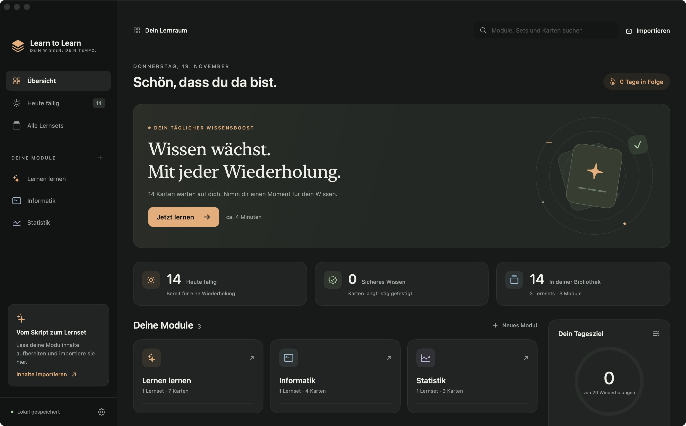

# Learn to Learn

Eine native, deutschsprachige macOS-App zum Lernen mit Karteikarten und interaktiven Fragen. SwiftUI, lokale JSON-Speicherung, keine Drittanbieter-Abhängigkeiten, kein Konto und keine Serververbindung.



## Starten

Voraussetzungen: macOS 14 oder neuer und Xcode 15 oder neuer mit Swift 5.9+. Getestet mit macOS 15.6.1, Xcode 16.2 und Apple Silicon.

```sh
./scripts/build-app.sh
open "dist/Learn to Learn.app"
```

Die erstellte App kannst du nach `/Applications` ziehen. Das ZIP in `dist/LearnToLearn-macOS.zip` enthält die App. Der lokale Build wird ad hoc signiert; für eine öffentliche Distribution mit regulärer Gatekeeper-Freigabe ist zusätzlich eine Developer-ID-Signatur und Notarisierung erforderlich. Der Build verwendet die Architektur des ausführenden Macs.

Für Entwicklung: `Package.swift` in Xcode öffnen oder `swift run LearnToLearn`. Tests: `swift test`. Das Buildskript akzeptiert optional `debug` statt `release`.

## Funktionen

- Module mit eigener Farbe und Symbol; beliebig viele Lernsets pro Modul.
- Sieben Fragetypen: Karteikarten, Multiple Choice (Einzel- und Mehrfachauswahl), Freitext, Wahr/Falsch, Lückentext, Reihenfolge und Zuordnung.
- Anlegen, Bearbeiten und Löschen von Modulen, Sets und Karten. Löschen erfordert eine Bestätigung.
- Spaced Repetition: „Nochmal“, „Schwer“, „Gut“, „Leicht“ steuern die nächste Fälligkeit. Falsch beantwortete Aufgaben kommen am Ende der laufenden Einheit erneut.
- Freies Üben aller Karten eines Sets ohne Änderung von Zeitplan oder Statistik.
- Tagesziel, tägliche Lernserie, tatsächliche Aktivität der letzten sieben Tage und gefestigte Karten.
- Globale Suche über Module, Sets, Fragen, Antworten und Tags; Filter innerhalb eines Sets.
- JSON-Import per Zwischenablage, Datei oder Dateidrop in das Importfenster, mit Prüfung und Vorschau. Inhalts-Export und vollständige Sicherung/Wiederherstellung.
- Tastatur: `⌘I` importieren, `⌘⇧N` Modul anlegen, `⌘L` fällige Karten lernen, `⌘1` Übersicht, `⌘2` Lernsets, `⌘,` Einstellungen. In einer Lerneinheit `↩` prüfen/aufdecken und `1–4` bewerten. Im Karteneditor `⌘S` speichern.

Beim ersten Start werden drei ausdrücklich als Beispiele gekennzeichnete Module mit 14 Karten angelegt. „Lernen lernen“ führt durch alle Fragetypen. Beispielmodule können einzeln gelöscht werden.

## Eigene Modulinhalte übernehmen

1. Schicke deine Skripte, Notizen oder Kapitel im Chat und bitte um ein Learn-to-Learn-Lernpaket.
2. Nutze bei Bedarf die Chat-Vorlage aus dem Importfenster oder [Examples/Chat-Vorlage.txt](Examples/Chat-Vorlage.txt).
3. JSON in **Importieren** einfügen, Vorschau prüfen und übernehmen.

Das vollständige Format steht in [IMPORTFORMAT.md](IMPORTFORMAT.md). [Examples/Alle-Fragetypen.json](Examples/Alle-Fragetypen.json) ist direkt importierbar. Es gibt keine automatische KI-Bewertung freier Texte; die App vergleicht Musterantworten und hinterlegte Varianten. Formeln werden als Text angezeigt.

## Lernplan

Neue Karten sind sofort fällig. „Gut“ ergibt zunächst 1 Tag, dann 3 Tage und danach einen wachsenden Abstand anhand des individuellen Einfachheitsfaktors. „Leicht“ beginnt mit 4 Tagen. „Schwer“ verlängert vorsichtiger. „Nochmal“ setzt die Karte auf 10 Minuten und wiederholt sie zusätzlich innerhalb der Einheit. Jede Bewertung wird sofort gespeichert; eine abgebrochene Einheit verliert bereits bewertete Karten nicht. Intervalle liegen maximal bei 3.650 Tagen. Tage werden kalenderbasiert berechnet, sodass die lokale Uhrzeit über Zeitumstellungen erhalten bleibt.

Als gefestigt zählt eine Karte ab drei erfolgreichen Wiederholungen und mindestens sieben Tagen Intervall. Das Tagesziel zählt gespeicherte Bewertungen, einschließlich erneuter Versuche. Die Lernserie zählt aufeinanderfolgende Kalendertage mit Bewertungen und bleibt bis zum Ende des heutigen Tages bestehen, wenn gestern gelernt wurde.

## Speicherung und Sicherung

Die Daten liegen unter `~/Library/Application Support/LearnToLearn/library.json`. Änderungen werden atomar gespeichert, die vorige gültige Version als `library.json.backup` erhalten. Eine unlesbare Datei wird nicht automatisch überschrieben. Bei Lesefehlern lässt sich eine gültige Sicherung in den Einstellungen wiederherstellen. Vollständige Sicherungen enthalten Lernfortschritt und Statistik. Das Wiederherstellen bewahrt die vorherige Datei zusätzlich unter einem eindeutigen Namen auf.

Zum isolierten Testen ohne Änderung eigener Lerndaten:

```sh
"dist/Learn to Learn.app/Contents/MacOS/LearnToLearn" --data-dir /tmp/learn-to-learn-test
```

## Projekt

- `Sources/LearnCore`: Modelle, Importprüfung, Antwortvergleich, Wiederholungsplan und Persistenz.
- `Sources/LearnToLearn`: native SwiftUI-Oberfläche, Editor, Import, Einstellungen und Lerneinheiten.
- `Tests/LearnCoreTests`: Tests für alle Fragetypen im Import, Validierung, Wiederholungen, Antworten, Lernserie und Sicherungen.
- `Tests/AppIntegrationTests`: Prüfung von Anlegen/Bearbeiten/Löschen, Importen mit Erhalt des Fortschritts, Neustarts und Wiederherstellung beschädigter Daten.
- `scripts`: reproduzierbarer App-Build und mit AppKit erzeugtes App-Icon.

CI prüft auf macOS die Tests und erstellt eine startbare App als Workflow-Artefakt.
